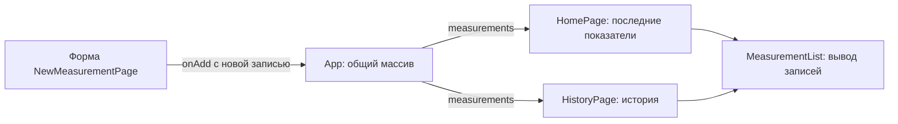

# Лабораторная № 1 — как устроен frontend

[README и запуск](../../README.md) · [Лабораторная № 2](lab2.md)

Здесь разобран существующий код «Рядом»: от первого открытия страницы до появления нового измерения в истории. Удобно читать гайд с открытым редактором и переходить по ссылкам на файлы. Команды запуска находятся в README; здесь основное внимание — тому, что происходит внутри приложения.

## 1. Общая схема и основные понятия

**Компонент** — функция React, которая возвращает описание интерфейса на JSX. JSX похож на HTML, но позволяет вставлять JavaScript в фигурных скобках. **Props** — параметры компонента, полученные от родителя. **Состояние** — данные, при изменении которых React заново вычисляет нужный интерфейс. Файлы `.tsx` содержат TypeScript и JSX.

В нашем приложении `App` хранит общий массив записей. Главная и история получают этот массив через props, а форма получает функцию добавления:



Здесь нет запросов к серверу: записи находятся в памяти вкладки. Переход между страницами сохраняет `App`, поэтому сохраняется и его состояние. При F5 приложение создаётся заново и возвращает демоданные. Backend второй работы существует отдельно и пока не подключён к этим компонентам.

## 2. `main.tsx`: как React появляется на странице

В [index.html](../../index.html) есть элемент с `id="root"`. [src/main.tsx](../../src/main.tsx) находит его и запускает дерево компонентов:

```tsx
createRoot(document.getElementById("root")!).render(
  <StrictMode>
    <ThemeProvider theme={theme}>
      <CssBaseline />
      <BrowserRouter>
        <App />
      </BrowserRouter>
    </ThemeProvider>
  </StrictMode>,
);
```

`createRoot` связывает React с DOM-элементом, а `render` задаёт содержимое. Знак `!` сообщает TypeScript, что элемент существует; сам по себе он не проверяет HTML во время работы.

Обёртки выполняют разные задачи: `StrictMode` включает дополнительные проверки разработки, `ThemeProvider` передаёт тему Material UI, `CssBaseline` задаёт базовые стили, `BrowserRouter` позволяет выбирать страницу по URL. `App` находится внутри них и может использовать их возможности. В режиме разработки `StrictMode` может повторно вызывать некоторые функции для поиска ошибок; это не означает двойное сохранение по нажатию кнопки.

## 3. Типы и демоданные: какую запись мы храним

В [types/measurement.ts](../../src/types/measurement.ts) перечислены пять строк: `pulse`, `pressure`, `temperature`, `sugar`, `weight`. `as const` сохраняет их как конкретные значения, а `(typeof measurementTypes)[number]` получает тип «одно из значений массива».

У всех записей есть `id`, `measuredAt` и `note`. Дальше предусмотрены два варианта: обычный показатель с `value` и давление с `systolic` и `diastolic`.

```ts
export type Measurement = ScalarMeasurement | PressureMeasurement;
export type NewMeasurement =
  Omit<ScalarMeasurement, "id"> | Omit<PressureMeasurement, "id">;
```

Вертикальная черта означает «один из вариантов». `Omit<..., "id">` исключает идентификатор: форма создаёт запись без ID, а `App` добавляет его. В `ScalarMeasurement` конструкция `Exclude<MeasurementType, "pressure">` не даёт записать давление как показатель с одним числом.

Когда код проверяет `measurement.type === "pressure"`, TypeScript понимает, что у записи доступны два поля давления. Это помогает находить ошибки при написании программы. Ввод пользователя всё равно проверяется отдельно: TypeScript не проверяет текст в браузерной форме. Функция `isMeasurementType` выполняет такую проверку для выбранного типа во время работы через `some`.

В [data/measurements.ts](../../src/data/measurements.ts) находятся два разных вида данных:

- `measurementInfo` — справочник названий, единиц и цветов. Например, по ключу `pulse` интерфейс получает «Пульс» и «уд/мин». `Record<MeasurementType, ...>` требует запись для каждого типа.
- `createDemoMeasurements()` — функция, возвращающая десять учебных записей. Вложенная `ago(minutes)` вычитает минуты из текущего времени и превращает результат в ISO-строку.

Функция нужна, чтобы даты рассчитывались при создании приложения. Добавление пользователем не переписывает этот файл: меняется только состояние React.

## 4. `App.tsx`: общий массив и добавление записи

Основная логика находится в [App.tsx](../../src/App.tsx):

```tsx
const [measurements, setMeasurements] = useState(createDemoMeasurements);
```

`measurements` — текущий массив, `setMeasurements` — функция его обновления. В `useState` передана сама функция `createDemoMeasurements`, без `()`: React использует её для начального состояния, а не создаёт демомассив при каждой обычной перерисовке.

Обработчик добавления:

```tsx
function addMeasurement(measurement: NewMeasurement) {
  setMeasurements((previous) => [
    { ...measurement, id: crypto.randomUUID() },
    ...previous,
  ]);
  setNotificationOpen(true);
}
```

`previous` — актуальное предыдущее состояние. `...measurement` копирует поля новой записи, `crypto.randomUUID()` создаёт строковый ID, а `...previous` добавляет старые элементы после нового. В итоге получается **новый массив**, который React получает через setter. Мы не изменяем прежний массив командой `push`.

Форма получает обработчик, а страницы — записи:

```tsx
<NewMeasurementPage onAdd={addMeasurement} />
```

Это передача функции, а не её вызов. Форма вызовет `onAdd` только после проверки полей. Проп `measurements` аналогично передаётся в `HomePage` и `HistoryPage`. Общее состояние находится выше страниц, чтобы они видели одни и те же данные.

`notificationOpen` — отдельное логическое состояние. После добавления оно становится `true`, открывая `Snackbar` с сообщением. Уведомление расположено вне `Routes`, поэтому переход с формы в историю его не убирает. Оно закрывается по кнопке или через 6000 мс; причина `clickaway` специально игнорируется.

## 5. Форма: почему значения сначала строки

[NewMeasurementPage.tsx](../../src/pages/NewMeasurementPage.tsx) хранит выбранный тип, числовые поля, дату, заметку и ошибки в локальном `useState`. Эти данные нужны только форме, поэтому их не поднимают в `App`.

У поля есть `value={value}` и `onChange={(event) => setValue(event.target.value)}`. Первое задаёт отображаемый текст из состояния, второе обновляет состояние при вводе. Такое поле называют **управляемым**: React знает его текущее содержимое.

Даже числовые поля сначала содержат строки. Пользователь может очистить поле или написать незавершённое `36,`; такие промежуточные состояния неудобно хранить числом. Преобразование в `number` происходит после успешной проверки.

При выборе `pressure` JSX показывает два поля вместо одного. Обработчик смены типа очищает числовые значения и ошибки, но оставляет дату и заметку. `measurementInfo[type]` даёт подписи и единицы выбранного показателя. Для заметки задан браузерный `maxLength: 500` и счётчик символов.

## 6. `validateNumber` и проверка даты

`validateNumber(value, integer)` возвращает текст ошибки либо `undefined`, если всё хорошо. Параметр `integer` сообщает, нужно ли целое число.

```ts
const normalized = value.trim().replace(",", ".");
```

`trim` убирает пробелы по краям, `replace` заменяет запятую точкой. Затем проверки идут по порядку: пустота, формат через регулярное выражение, конечность числа, положительность и при необходимости `Number.isSafeInteger`. Выражение `^\d+(\.\d+)?$` допускает цифры и необязательную дробную часть после точки, но отклоняет буквы, знак минус и незавершённую дробь.

| Ввод | Что произойдёт |
| --- | --- |
| Пустая строка | «Введите значение» |
| `0` | Ошибка положительности |
| `abc`, `-5`, `36,` | Ошибка формата |
| Пульс `72.5` | Ошибка: требуется целое число |
| Температура ` 36,6 ` | Пройдёт проверку, сохранится число `36.6` |

Медицинские нормы здесь не проверяются: функция проверяет корректность записи.

Дата обрабатывается в [utils/format.ts](../../src/utils/format.ts). `toLocalDateTime` собирает местное время в формате `YYYY-MM-DDTHH:mm` для `datetime-local`. `parseLocalDateTime` проверяет формат, создаёт `Date`, затем сравнивает исходную строку с обратным преобразованием. Это важно: JavaScript может перенести несуществующий день на следующий месяц. Несовпадение приводит к `null`.

После успешной проверки форма вызывает `date.toISOString()`. Получается момент времени в UTC. Например, `09:00` в зоне UTC+3 соответствует `06:00Z`; при отображении `formatDate` снова использует местный часовой пояс устройства. Запрета будущих дат в этой работе нет.

## 7. `handleSubmit`: что происходит после «Сохранить»

Кнопка имеет `type="submit"`, а форма — `onSubmit={handleSubmit}`. Поэтому обработчик работает и при обычной отправке формы с клавиатуры.

1. `event.preventDefault()` отменяет стандартную перезагрузку страницы при отправке HTML-формы.
2. Создаётся `nextErrors`. Для давления проверяются два значения, для остальных типов — одно; затем проверяется дата.
3. `setErrors(nextErrors)` передаёт ошибки интерфейсу. У `TextField` свойства `error` и `helperText` показывают неверное поле и пояснение. Атрибут `noValidate` отключает стандартные браузерные подсказки, чтобы сообщения показывал сам интерфейс.
4. `Object.keys(nextErrors).find(...)` ищет первую непустую ошибку. Поле находится по `name` через `elements.namedItem`, получает фокус, а `return` останавливает сохранение. Конструкция `key as keyof FormErrors` уточняет TypeScript, что ключ принадлежит объекту ошибок.
5. При корректном вводе собираются общие поля: ISO-дата и заметка без крайних пробелов. Числовые строки преобразуются через `Number`.
6. Вызывается `onAdd` с нужными числовыми полями, затем `navigate("/measurements")` открывает историю.

**Пример целиком:** вы вводите температуру `36,6` → строка проходит проверку → создаётся объект с `type: "temperature"` и `value: 36.6` → `App` добавляет ID и обновляет массив → история получает новый массив → `MeasurementList` выводит запись. Если вместо числа было `abc`, выполнение остановится до `onAdd`.

Кнопка «Отмена» — ссылка на историю. Она не вызывает обработчик добавления, поэтому введённые поля теряются, а общий массив остаётся прежним.

## 8. История и главная: как выбираются записи

[HistoryPage.tsx](../../src/pages/HistoryPage.tsx) хранит только выбранный фильтр:

```tsx
const [filter, setFilter] = useState<MeasurementType | "all">("all");
const filteredMeasurements = sortMeasurements(measurements).filter(
  (measurement) => filter === "all" || measurement.type === filter,
);
```

При `all` проходят все записи; иначе — только совпадающий тип. `filter` создаёт новый массив, поэтому скрытые записи не удаляются. Повторный вход на страницу может сбросить фильтр, но не общий массив в `App`.

В `sortMeasurements` используется:

```ts
return [...measurements].sort(
  (a, b) => Date.parse(b.measuredAt) - Date.parse(a.measuredAt),
);
```

`Date.parse` превращает даты в числовые отметки времени; порядок `b - a` размещает новые записи первыми. Копия `[...measurements]` нужна потому, что `sort` изменяет массив, на котором вызван. Так props остаются нетронутыми.

[HomePage.tsx](../../src/pages/HomePage.tsx) тоже сортирует массив. Для каждого типа метод `find` берёт первую подходящую запись, то есть самую свежую по времени измерения. `slice(0, 5)` выбирает пять записей для нижнего списка. Если у пульса уже есть запись за 10:00, добавление записи за 09:00 не заменит карточку; запись за 11:00 заменит. При отсутствии показателя выводятся прочерк и «Пока нет записей».

## 9. Общие компоненты и переходы

[MeasurementList.tsx](../../src/components/MeasurementList.tsx) получает уже подготовленный массив: на главной — пять записей, в истории — отфильтрованные. Он сам не выбирает последние показатели и не сохраняет данные. Через `map` компонент создаёт строки таблицы и мобильные карточки. `key={measurement.id}` помогает React сопоставить элементы при обновлении списка.

Если массив пуст, компонент сразу возвращает сообщение и кнопку добавления. Проп `filtered` меняет текст: «Измерений этого типа пока нет» или «Пока нет измерений». `formatValue` выводит дробь с русской запятой, а давление — как `120/80`; исходные числовые поля при этом не меняются. [MeasurementIcon.tsx](../../src/components/MeasurementIcon.tsx) выбирает иконку из объекта по типу, а цвета — из `measurementInfo`.

В `App` компонент `Routes` выбирает `Route` по адресу: `/`, `/measurements`, `/measurements/new`. Путь `*` показывает [NotFoundPage](../../src/pages/NotFoundPage.tsx). `Link` и `NavLink` выполняют клиентский переход без полной перезагрузки; `navigate` делает то же из обработчика.

[Layout.tsx](../../src/components/Layout.tsx) — общий каркас с меню, верхней панелью и областью содержимого. Проп `children` — текущая страница внутри каркаса. `NavLink` получает `isActive` и выделяет текущий пункт; `end` требует полного совпадения маршрута, чтобы «История» не подсвечивалась одновременно с формой.

`useLocation` даёт `pathname`. Эффект с зависимостью `[pathname]` обновляет название вкладки, прокрутку и фокус после перехода. `useRef` хранит предыдущий адрес без вызова перерисовки. На первом открытии фокус в `main` не переносится: с клавиатуры остаётся доступна ссылка «К содержимому».

## 10. Оформление и служебные файлы

[theme.ts](../../src/theme.ts) задаёт общие настройки Material UI через `createTheme`: палитру, типографику и оформление компонентов. [styles.css](../../src/styles.css) отвечает за сетки, расположение и адаптивность; `sx` задаёт небольшие локальные стили. При ширине до 760 px вместо таблицы видны карточки истории, а поля давления располагаются друг под другом. Оба представления создаёт один компонент, видимость переключается CSS.

| Файл | Что нужно понимать |
| --- | --- |
| `package.json` | Зависимости и команды: `dev` запускает Vite, `typecheck` — TypeScript, `lint` — ESLint, `build` — проверку типов и сборку |
| `package-lock.json` | Фиксирует версии для воспроизводимой установки через `npm ci` |
| `vite.config.ts` | Подключает React-плагин и разделяет часть библиотек на отдельные файлы сборки |
| `tsconfig*.json` | Настраивают проверку TypeScript; конфигурация `node` относится к инструментам, а не к backend |
| `eslint.config.js` | Настраивает проверку ошибок и правил React |
| `.gitignore` | Исключает зависимости, сборку, временные файлы и секреты из Git |

## 11. Что показать и объяснить на защите

Начните с главной, затем откройте историю, отфильтруйте пульс, добавьте температуру и покажите новую запись. После этого продемонстрируйте ошибку на дробном пульсе и сброс добавленных данных после F5. В редакторе откройте `App`, форму и историю: на них виден весь путь данных.

| Вопрос | Короткий ответ |
| --- | --- |
| Почему массив в `App`? | Он нужен нескольким страницам; общий родитель передаёт им одни данные |
| Как форма изменяет родителя? | Вызывает переданную функцию `onAdd`, а родитель обновляет своё состояние |
| Зачем строки в числовых полях? | Во время ввода бывают пустые и незавершённые значения; число создаётся после проверки |
| Почему TypeScript не заменяет валидацию? | Он проверяет код, а пользовательский ввод появляется во время работы |
| Почему после F5 записи пропадают? | Состояние React создаётся заново, постоянное хранилище не подключено |
| Зачем копия перед сортировкой? | `sort` меняет исходный массив, а props изменять не следует |

Ранее выполненные проверки интерфейса перечислены в [протоколе](../verification.md). 8 ноября 2026 года повторно прошли проверка типов, линтер, сборка и основные браузерные сценарии. При обновлении этого гайда код приложения не менялся.

Скриншоты: [главная](../screenshots/home-desktop.png), [история](../screenshots/history-desktop.png), [форма](../screenshots/new-measurement-desktop.png), [форма давления](../screenshots/new-pressure-desktop.png), [главная на телефоне](../screenshots/home-mobile.png), [история на телефоне](../screenshots/history-mobile.png).
