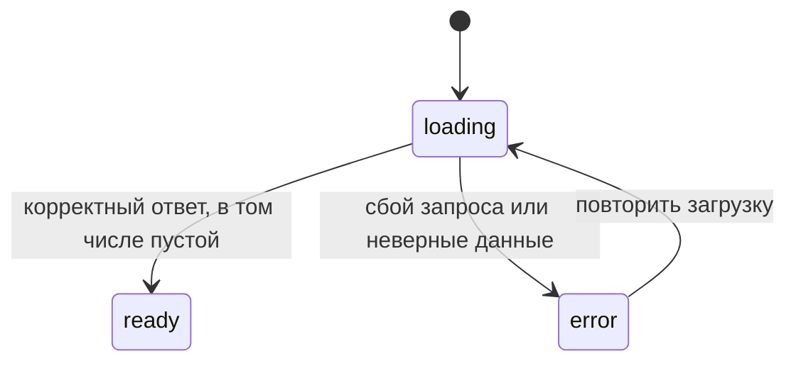

# Лабораторная № 3 — структура frontend и динамический интерфейс

[README и запуск](../../README.md) · [Лаба № 1](lab1.md) · [Лаба № 2](lab2.md)

Третья работа развивает интерфейс «Рядом»: добавляет редактирование, удаление, поиск и сортировку, выносит повторяющуюся форму в отдельный компонент и вводит состояния загрузки. Ниже — разбор текущего кода по файлам. Базовые понятия React подробно объяснены в первом гайде; здесь рассматриваем, как они применяются в новой версии.

## 1. Что изменилось и что осталось демонстрационным

Раньше `App` сразу создавал десять демозаписей и позволял только добавлять новые. Теперь записи загружаются через `fetch` из локального JSON, после чего можно добавлять, редактировать и удалять их. Главная и история получают один общий массив и обновляются вместе.

Это ещё не интеграция с FastAPI. HTTP-запрос идёт к статическому файлу, который отдаёт Vite или сервер сборки. Изменения живут в памяти вкладки: F5 заново загружает исходные десять записей. Backend второй работы и его PostgreSQL не изменялись. Такой режим разрешён заданием № 3 и позволяет проверить поведение интерфейса до подключения настоящего API.

## 2. Упрощённая FSD: как распределены файлы

FSD здесь используется как ориентир для разделения ответственности, без сложных правил и дополнительных библиотек.

| Слой | Главные файлы | Ответственность |
| --- | --- | --- |
| `app` | [main.tsx](../../src/app/main.tsx), [App.tsx](../../src/app/App.tsx), [Layout.tsx](../../src/app/Layout.tsx), тема и стили | Запуск, маршруты, сборка приложения и общий каркас |
| `pages` | Главная, история, создание, [редактирование](../../src/pages/EditMeasurementPage.tsx), 404 | Собирают экран из готовых компонентов, выполняют переходы |
| `features` | [MeasurementForm](../../src/features/measurement-form/MeasurementForm.tsx), [MeasurementFilters](../../src/features/filter-measurements/MeasurementFilters.tsx), [DeleteMeasurementDialog](../../src/features/delete-measurement/DeleteMeasurementDialog.tsx) | Пользовательские действия: заполнить форму, настроить список, подтвердить удаление |
| `entities/measurement` | `model`, `api`, `lib`, `ui` | Типы измерений, состояние, загрузка, форматирование и вывод записей |
| `shared` | [date.ts](../../src/shared/lib/date.ts), [DataState.tsx](../../src/shared/ui/DataState.tsx) | Код без привязки к конкретному показателю: даты и отображение состояния загрузки |

Страницы могут использовать features и entities. Форма использует типы измерений и общие функции даты. При этом `MeasurementList` из entities не импортирует страницу или действие удаления: нужные кнопки ему передаёт история. Так нижние слои не зависят от верхних.

Не каждый файл нужно превращать в папку или оборачивать дополнительным классом. Для этого проекта достаточно прямых импортов, функций и props.

## 3. `loadMeasurements`: настоящая загрузка учебного файла

В [public/demo/measurements.json](../../public/demo/measurements.json) лежат десять записей. Вместо фиксированной даты у них есть `minutesAgo`: сколько минут прошло с момента измерения. Это позволяет показывать свежие учебные даты при каждом запуске.

[loadMeasurements.ts](../../src/entities/measurement/api/loadMeasurements.ts) начинает с:

```ts
const response = await fetch("/demo/measurements.json", { signal });
```

`await` ждёт завершения запроса, не блокируя интерфейс. `signal` позволяет отменить его. Проверка `response.ok` нужна, поскольку `fetch` не выбрасывает исключение только из-за HTTP-статуса `404` или `500`.

Результат `response.json()` принимается как `unknown`: TypeScript не знает, какие данные действительно пришли по сети. Затем функция проверяет массив и каждую запись: уникальный строковый ID, допустимый тип, заметку, конечный неотрицательный `minutesAgo` и числовые поля. Проверки через `typeof` и оператор `in` постепенно уточняют тип значения.

Для давления нужны два положительных целых числа; для остальных показателей — одно положительное конечное число, причём пульс тоже целый. Из `Date.now() - minutesAgo * 60_000` получается дата, которая преобразуется в ISO-строку. Возвращается уже проверенный `Measurement[]` с привычным полем `measuredAt`.

Если JSON повреждён или структура неверна, загрузка завершается ошибкой целиком. Неправильные записи не попадают в интерфейс. Пустой массив `[]` — допустимый результат, а не ошибка.

## 4. `useMeasurements`: общий массив и состояния запроса

В [useMeasurements.ts](../../src/entities/measurement/model/useMeasurements.ts) находится пользовательский хук. Хук — функция, которая объединяет React-состояние и связанную с ним логику. В проекте он вызывается один раз, в `App`, поэтому у всех страниц один журнал.

Внутри хранятся `measurements`, `status`, `error` и номер попытки `attempt`. Тип статуса ограничен тремя строками: `loading`, `ready`, `error`.



Эффект с зависимостью `[attempt]` создаёт `AbortController` и вызывает загрузчик. В `.then` данные попадают в состояние и выставляется `ready`; в `.catch` появляется понятное сообщение и статус `error`. Перед обновлением состояния проверяется `controller.signal.aborted`.

Очистка эффекта возвращает `() => controller.abort()`. Это важно при размонтировании и дополнительных проверках `StrictMode`: старый запрос не должен обновлять состояние уже после отмены. Отмена не показывается пользователю как ошибка сети.

`retry()` очищает сообщение, ставит `loading` и увеличивает `attempt`. React запускает эффект для новой попытки. Повторная загрузка доступна на экране ошибки; отдельной кнопки сброса текущих изменений в журнале нет.

## 5. Добавление, изменение и удаление массива

Хук возвращает три простые функции. `add` создаёт новый объект со строковым UUID и новый массив, где запись стоит перед остальными. `remove` использует `filter`, оставляя все записи, кроме выбранного ID.

Обновление выполнено через `map`:

```ts
setMeasurements((previous) => previous.map((item) =>
  item.id === id ? { ...measurement, id } : item,
));
```

Для совпавшего ID создаётся объект из **новых полей**, а прежний ID сохраняется. Остальные элементы возвращаются без изменений. Здесь специально нет `...item`: если заменить давление на вес, старые `systolic` и `diastolic` не должны остаться в записи.

Функциональная форма setter получает актуальное предыдущее состояние. Ни одна операция не меняет существующий массив через `push` или `splice`. После обновления `App` передаёт новый массив страницам, и React пересчитывает интерфейс.

## 6. `App` и `DataState`: кто выбирает экран

`App` получает журнал из хука и передаёт состояние в общий `DataState`. Пока идёт загрузка, видны индикатор и сообщение с `role="status"`; при ошибке — `Alert` и кнопка повтора. В состоянии `ready` компонент возвращает `children`, то есть маршруты приложения.

Благодаря этому форма не позволяет создать запись до окончания первоначальной загрузки: поздний ответ не перезапишет только что добавленные данные. Каркас и навигация при этом остаются на экране. Пустой список обрабатывает уже `MeasurementList`, потому что загрузка пустого журнала завершилась успешно.

Маршруты сохранились, дополнительно появился `/measurements/:id/edit`. После действия `App` вызывает соответствующую функцию хука и меняет текст `Snackbar`: запись добавлена, изменения сохранены или запись удалена. Уведомление расположено вне переключаемой страницы и остаётся видимым после перехода.

## 7. Одна форма для создания и редактирования

[MeasurementForm.tsx](../../src/features/measurement-form/MeasurementForm.tsx) принимает два props: необязательное `initialMeasurement` и функцию `onSave`.

Если начальной записи нет, поля пустые, тип — пульс, дата — текущая. Если запись есть, состояния инициализируются её значениями. В обоих режимах числа в полях хранятся строками, чтобы можно было очищать поле и вводить дробь постепенно.

Форма не знает маршрутов сохранения и не управляет общим массивом. Она проверяет ввод, создаёт `NewMeasurement` и вызывает `onSave`. Страница создания связывает этот вызов с `onAdd`, страница редактирования — с `onUpdate(id, data)`. После этого сама страница вызывает `navigate("/measurements")`.

`EditMeasurementPage` берёт ID из `useParams()` и ищет запись в общем массиве. Если ID отсутствует, показывает сообщение и ссылку на историю. Это возможно, например, если открыть старую ссылку на добавленную запись после F5. `key={measurement.id}` у формы позволяет создать новое локальное состояние, если выбран другой ID; страница также пересоздаётся при смене пути.

При смене типа форма очищает числовые поля и ошибки, сохраняя дату и заметку. «Отмена» просто открывает историю без вызова `onSave`, поэтому несохранённые изменения пропадают.

## 8. Валидация: как ошибочный ввод останавливает сохранение

Общая функция [validateNumber](../../src/entities/measurement/model/validation.ts) вынесена из страницы в модель измерения. Она убирает пробелы, заменяет запятую точкой и проверяет формат, конечность и положительность. Для пульса и давления дополнительно требуется безопасное целое число.

В `handleSubmit` порядок такой: отмена стандартной отправки HTML-формы → проверка чисел → проверка даты → проверка длины заметки → показ ошибок. Если ошибка есть, первое неверное поле получает фокус, и функция выходит через `return` до вызова `onSave`.

Дата проверяется общими функциями из `shared/lib/date.ts`: обратное преобразование обнаруживает несуществующий день, который JavaScript мог бы перенести на другой месяц. Заметка ограничена 500 символами и в HTML-поле, и в обработчике. Пустая заметка допустима. Медицинские нормы и запрет будущей даты не добавлялись.

Пример: редактируем пульс, вводим `72.5` → получаем ошибку целого числа → исходная запись в общем массиве не изменяется. Исправляем на `73` → `onSave` получает число `73` → хук заменяет запись → история и главная показывают новое значение.

## 9. Поиск, фильтр, сортировка и общий список

[HistoryPage.tsx](../../src/pages/HistoryPage.tsx) хранит выбранный тип, строку поиска и порядок записей. `MeasurementFilters` получает эти значения и обработчики изменения через props. Сам компонент фильтров не хранит вторую копию состояния и не изменяет данные журнала.

Сначала `sortMeasurements` создаёт копию массива и сортирует по времени от новых к старым. Затем `filter` одновременно проверяет тип и вхождение текста в заметку. Поиск убирает пробелы по краям запроса и приводит обе строки к нижнему регистру. Поэтому ` УТРЕННЕЕ ` находит «Утреннее измерение».

Для порядка «сначала старые» вызывается `visible.reverse()`. Это безопасно: `visible` уже новый массив после сортировки и фильтрации. «Сбросить» возвращает тип `all`, пустой поиск и порядок `newest`. При уходе со страницы локальные фильтры сбрасываются; записи остаются в общем хуке.

[MeasurementList.tsx](../../src/entities/measurement/ui/MeasurementList.tsx) выводит таблицу или мобильные карточки. Новый prop `renderActions` — функция, которая получает запись и возвращает JSX кнопок. История передаёт «Изменить» и «Удалить», главная этот prop не передаёт. Так один список используется на двух страницах, а entity-компонент не зависит от конкретной feature.

Для пустого журнала выводится приглашение добавить запись. Для отсутствия совпадений — предложение изменить поиск или фильтр. Счётчик показывает число видимых записей и общее количество.

## 10. Подтверждение удаления и обновление главной

При нажатии «Удалить» история кладёт выбранную запись в `toDelete`. Пока там объект, [DeleteMeasurementDialog](../../src/features/delete-measurement/DeleteMeasurementDialog.tsx) открыт; при `null` он закрыт. В диалоге показаны тип, значение, единицы и время, чтобы было понятно, что именно удаляется.

«Отмена», Escape или закрытие диалога вызывают только `onCancel`. Кнопка подтверждения передаёт ID в `onConfirm`, история вызывает удаление и очищает `toDelete`. На кнопку отмены поставлен начальный фокус, а Material UI обеспечивает работу фокуса внутри диалога.

После удаления обновляется общий массив. Главная по-прежнему сортирует его и выбирает через `find` самое свежее измерение каждого типа. Если удалить последнюю по времени температуру, карточка покажет предыдущую. Если удалить все температуры — прочерк. Если удалить последнюю запись вообще — история перейдёт в пустое состояние.

## 11. Анимации и доступность

В [app/styles.css](../../src/app/styles.css) определена короткая анимация `appear`: прозрачность от 0 до 1 и смещение вверх на 6 px за 180 мс. Она помогает заметить открытие страницы и появление новой строки.

Контейнер страницы в `App` имеет `key={pathname}`, поэтому появление запускается при переходе по адресу. Обычный ввод в поле не меняет путь и не пересоздаёт форму. Строки списка имеют `key={measurement.id}`: редактирование не выдаёт записи новый ID.

У диалога есть переход длительностью 160 мс. Если включено `prefers-reduced-motion`, CSS отключает анимации, а `useMediaQuery` передаёт диалогу длительность 0. Навигация, фокус ошибки, клавиатурная отправка и ссылка «К содержимому» работают без анимации. Скрытая ссылка остаётся доступной через Tab, но не перехватывает мышь.

## 12. Как проверить работу и воспроизвести состояния

Обычный сценарий: главная → история → поиск → добавление → редактирование → отмена удаления → подтверждение удаления. Проверьте, что главная обновилась, а после F5 вернулись демоданные. На телефоне те же действия доступны в карточках.

Для проверки ошибки в DevTools включите Network request blocking для `*/demo/measurements.json` и обновите страницу. Появится ошибка; отключите блокировку и нажмите «Повторить загрузку». Для индикатора включите замедление сети и обновите страницу. Эти настройки меняют только вашу тестовую сессию браузера.

Для пустого журнала можно временно заменить содержимое JSON на `[]` в рабочей копии и обновить страницу. Затем обязательно восстановите файл. Автоматический тест делает эти подмены через Playwright и не меняет исходные демоданные.

### Автоматическая проверка в браузере

В [tests/frontend_scenarios.py](../../tests/frontend_scenarios.py) проверяются реальные элементы страницы. `expect` ждёт нужного состояния; `page.route` позволяет вернуть ошибку, пустой массив или задержать ответ. Фиксированное время делает демодаты в скриншотах воспроизводимыми. Отдельных тестовых переключателей в приложении нет.

Сначала из корня проекта:

```bash
npm run typecheck
npm run lint
npm run build
npm run preview
```

Во втором терминале создайте отдельное Python-окружение для браузерных тестов. macOS/Linux:

```bash
python3 -m venv tests/.venv
tests/.venv/bin/python -m pip install -r tests/requirements.txt
tests/.venv/bin/python -m playwright install chromium
tests/.venv/bin/python tests/frontend_scenarios.py
```

Windows PowerShell:

```powershell
py -m venv tests/.venv
.\tests\.venv\Scripts\python.exe -m pip install -r tests/requirements.txt
.\tests\.venv\Scripts\python.exe -m playwright install chromium
.\tests\.venv\Scripts\python.exe tests/frontend_scenarios.py
```

Python нужен только для автоматической проверки; сам frontend запускается через Node.js. По умолчанию тест обращается к `http://localhost:4173`; переменная `BASE_URL` позволяет выбрать другой адрес. `CHROMIUM_PATH` необязателен и указывает путь к уже установленному Chromium. Для пересъёмки изображений задайте `SCREENSHOTS=1` (в PowerShell: `$env:SCREENSHOTS="1"`). Без этой переменной скриншоты в репозитории не перезаписываются.

Результаты и перечень снимков находятся в [протоколе третьей работы](../verification-lab3.md).

## 13. Что объяснить на защите

| Вопрос | Ответ по нашему коду |
| --- | --- |
| Зачем вынесли форму? | Создание и редактирование используют одинаковые поля и правила; меняются начальные значения и `onSave` |
| Почему хук вызывается только в `App`? | Каждый отдельный вызов создал бы своё состояние; нам нужен один общий журнал |
| Почему сетевые данные имеют тип `unknown`? | Объявление TypeScript не гарантирует структуру полученного JSON; её проверяет загрузчик |
| Для чего `AbortController`? | Отменяет старый запрос и не даёт его результату обновить состояние после очистки эффекта |
| Что отличает пустой список от ошибки? | `[]` — успешная загрузка без записей; ошибка означает, что получить корректный журнал не удалось |
| Зачем `renderActions`? | Список остаётся общим, а нужные кнопки задаёт страница |
| Почему после смены давления на вес не остаются лишние поля? | `update` создаёт объект из новых полей, сохраняя только ID старой записи |
| Почему F5 сбрасывает изменения? | Постоянное хранение frontend ещё не подключено; снова загружается учебный JSON |

Показывая код, удобно идти в порядке `App` → `useMeasurements` → `loadMeasurements` → `MeasurementForm` → `HistoryPage`. Так виден весь путь данных без необходимости объяснять каждый декоративный элемент интерфейса.
